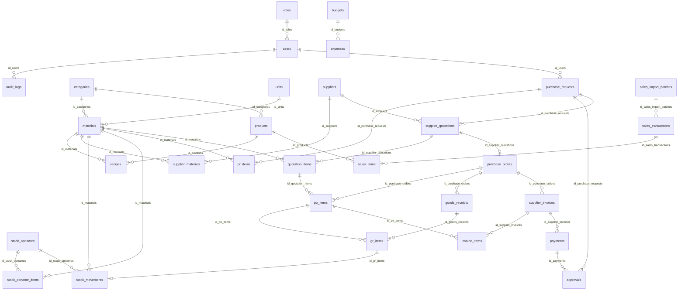

# 2. ERD final (sesuai `drizzle/schema.ts`)

Aturan: PK tiap tabel `id_<nama tabel>` (UUID); FK memakai nama yang sama dengan PK yang dirujuk; uang `NUMERIC(14,2)`; kuantitas `NUMERIC(14,3)`; waktu `TIMESTAMPTZ`; data turunan tidak disimpan (saldo stok, total PO/invoice, status bayar, supplier pada PO).

## Entitas, atribut utama, dan constraint

| Tabel | Atribut (PK **tebal**, FK _miring_) | Constraint/index penting |
|---|---|---|
| roles | **id_roles**, role_code, role_name | UNIQUE role_code; CHECK ∈ {admin, purchasing, finance, owner} |
| users | **id_users** (= auth.users.id), _id_roles_, full_name, email, is_active | FK → auth.users ON DELETE CASCADE; UNIQUE email |
| audit_logs | **id_audit_logs**, _id_users_, action, entity_type, entity_id, detail jsonb, logged_at | trigger append-only |
| categories, units | **id_…**, nama | UNIQUE nama |
| materials | **id_materials**, _id_categories_, _id_units_, sku, material_name, min_stock, safety_stock, is_active | UNIQUE sku; CHECK ≥ 0 |
| products | **id_products**, _id_categories_, sku, product_name, price, is_active | UNIQUE sku |
| recipes | **id_recipes**, _id_products_, _id_materials_, qty_used | UNIQUE(produk, bahan); CHECK > 0 |
| suppliers | **id_suppliers**, supplier_name, contact_name, phone, email, address, is_active | UNIQUE nama |
| supplier_materials | **id_supplier_materials**, _id_suppliers_, _id_materials_ | UNIQUE pasangan |
| stock_movements | **id_stock_movements**, _id_materials_, movement_type, qty_delta, moved_at, _id_users_, _id_gr_items_, _id_stock_opnames_, note | CHECK tanda sesuai jenis; UNIQUE id_gr_items; trigger append-only |
| stock_opnames / _items | nomor, tanggal, status; counted_qty | UNIQUE(opname, bahan) |
| purchase_requests / pr_items | pr_number, needed_by, status; qty | status CHECK; UNIQUE(PR, bahan) |
| approvals | **id_approvals**, _id_purchase_requests_ ∨ _id_payments_, _id_users_, decision, note | CHECK tepat satu target |
| supplier_quotations | _id_purchase_requests_, _id_suppliers_, valid_until, lead_time_days, payment_term_days, is_selected, selection_reason | UNIQUE(PR, supplier); **UNIQUE parsial satu terpilih per PR** |
| quotation_items | _id_supplier_quotations_, _id_materials_, unit_price, min_order_qty | UNIQUE pasangan |
| scoring_parameters / _history | criterion, weight / old, new, _id_users_, changed_at | weight 0–100; riwayat tiap perubahan |
| app_settings | setting_key, setting_value | ambang pembayaran, nilai awal supplier baru |
| purchase_orders / po_items | po_number, _id_supplier_quotations_ (UNIQUE), status, order_date, expected_date / _id_quotation_items_, qty_ordered | status CHECK; tanggal CHECK |
| goods_receipts / gr_items | gr_number, received_at / qty_accepted, qty_rejected | trigger: diterima ≤ dipesan |
| supplier_invoices / invoice_items | invoice_number, dates, status (recorded/matched/held), verified_by / qty_invoiced, unit_price | UNIQUE(PO, nomor) |
| payments | payment_number, _id_supplier_invoices_, amount, method, status, paid_at | status CHECK; amount > 0 |
| budgets / expenses | period (YYYY-MM), budget_amount / expense_date, description, amount | CHECK format periode |
| sales_import_batches | file_name, **file_hash UNIQUE**, row/imported/skipped_count | cegah impor berkas sama |
| sales_transactions / _items | trx_date, source, external_ref, _id_sales_import_batches_ / qty, unit_price | **UNIQUE parsial (source, external_ref)** |

View: `stock_balances` (saldo = Σ qty_delta, `security_invoker`). Index penutup FK dibuat oleh migrasi 0007.
